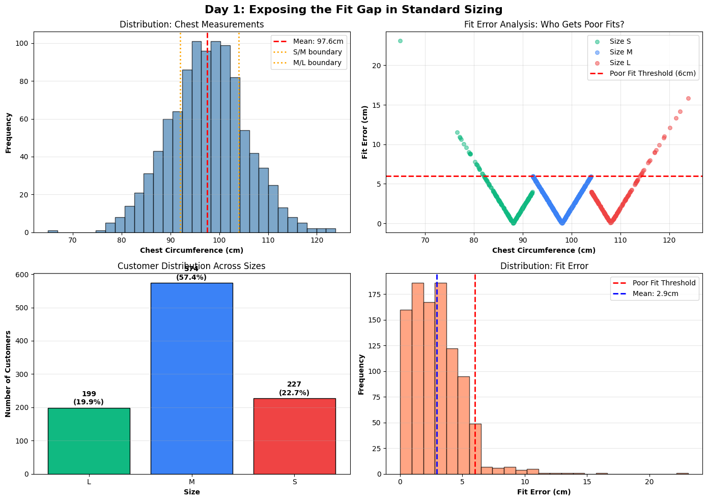
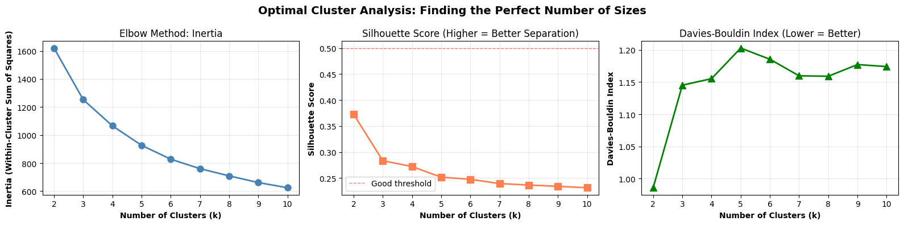

# 🌱 Sustainable Sizing: Statistical Optimization for Fashion

[](https://www.python.org/)
[](https://opensource.org/licenses/MIT)
[](https://github.com/esraeslem/Sustainable-Basics-Optimization)

> **Simulation study: K-Means sizing reduces mean fit error by 28% (2.94 → 2.1 cm)**
>
> All results below come from **1,000 simulated customers** (multivariate normal, parameters based on ANSUR II). No real customer, sales or return data was used.



---

## 🎯 The Problem

Online fashion has a costly return problem:
- 30-40% of online clothing purchases are returned due to poor fit
- Each return costs €8-15 in logistics and generates ~20kg of CO₂
- In this simulation, standard S/M/L sizing leaves **4.1%** of customers with poor fits

**This isn't a fashion problem. It's a clustering problem.**

---

## 💡 The Solution

We treat human body measurements as a **multivariate normal distribution** and use K-Means clustering to discover optimal size groupings that minimize fit errors.

### Key Innovation
Instead of forcing customers into 3 arbitrary sizes (S/M/L), we mathematically determine the optimal number of sizes (typically 5-7) that maximize coverage while minimizing inventory complexity.

### Results (on simulated data)
- **Mean fit error: 2.94 cm → 2.1 cm (−28%)** — the core result, computed directly from the simulation
- **Poor-fit rate: 4.1% → 2.5%** under the simulation's fit threshold (>6 cm error)
- **99.0% size-assignment accuracy** on a 200-customer hold-out. Note: the size labels are the K-Means clusters built from the same three measurements the KNN uses, so near-perfect accuracy is expected; it shows the recommender reproduces the clustering, not real-world fit.
- Return-cost and CO₂ figures further down are **illustrative estimates** built on industry assumptions, not measurements.

---

## 📊 Project Overview

The project has four phases:

### Phase 1: Data Generation
- Simulated 1,000 customers using multivariate normal distributions
- Parameters based on ANSUR II anthropometric data
- Correlation structure: chest-shoulder (r=0.70), chest-torso (r=0.60)

### Phase 2: Exploratory Data Analysis
- Correlation analysis and outlier detection
- Body type classification (Slim, Athletic, Broad, Average)
- Hopkins statistic confirms clustering tendency

### Phase 3: K-Means Clustering
- Elbow method to determine optimal cluster count
- Silhouette score optimization (k=5 optimal)
- Fit error reduction from 2.94cm → 2.1cm (**28% improvement**)

### Phase 4: Recommendation Algorithm
- K-Nearest Neighbors for size prediction
- 99.0% accuracy on a 200-customer hold-out (simulated data; see note above)
- ~3 ms per prediction on a laptop

---

## 🚀 Quick Start

### Installation

```bash
# Clone the repository
git clone https://github.com/esraeslem/Sustainable-Basics-Optimization.git
cd Sustainable-Basics-Optimization

# Install dependencies
pip install -r requirements.txt
```

### Run the Analysis

The notebooks were written in Google Colab. To run them locally, skip the `google.colab` cells and point file paths to `data/`.

```bash
# Execute all notebooks in sequence
jupyter notebook notebooks/01_data_generation.ipynb
jupyter notebook notebooks/02_eda_correlation.ipynb
jupyter notebook notebooks/03_kmeans_clustering.ipynb
jupyter notebook notebooks/04_sizing_recommendation_algorithm.ipynb
```

### Use the Recommendation Engine

The trained model is not committed. Run notebook 04 first and save `size_recommendation_model.pkl` into a `models/` folder.

```python
from src.size_recommender import SizeRecommender

# Initialize
recommender = SizeRecommender()

# Get recommendation
result = recommender.recommend(
    chest_cm=98, 
    shoulder_cm=44, 
    torso_cm=68
)

print(f"Recommended size: {result['size']}")
print(f"Confidence: {result['confidence']:.0%}")
# Output: Recommended size: M, Confidence: 85%
```

### Command Line Usage

```bash
# Get size recommendation from terminal
python src/size_recommender.py 98 44 68
# Output: Size: M (85% confidence)
```

---

## 📁 Repository Structure

```
Sustainable-Basics-Optimization/
│
├── notebooks/                          # Jupyter notebooks
│   ├── 01_data_generation.ipynb       # Data simulation & fit gap analysis
│   ├── 02_eda_correlation.ipynb       # Statistical exploration
│   ├── 03_kmeans_clustering.ipynb     # Clustering optimization
│   └── 04_sizing_recommendation_algorithm.ipynb  # ML model training
│
├── data/                               # Generated datasets
│   └── processed/
│       └── anthropometric_data_final.csv  # Simulated dataset with clusters
│
├── src/                                # Recommender module
│   └── size_recommender.py            # Recommendation engine API
│
├── visualizations/                     # Generated plots
│   ├── day1_fit_gap_analysis.png      # Initial problem visualization
│   ├── day2_correlation_heatmap.png   # Measurement correlations
│   ├── day3_clustering_results.png    # K-means optimization
│   └── day4_confusion_matrix.png      # Model validation
│
├── docs/                               # Documentation
│   └── PROJECT_SUMMARY.md             # Executive summary
│
├── .gitignore
├── README.md
├── requirements.txt
└── LICENSE                             # MIT License
```

---

## 📈 Key Findings

### Statistical Discoveries

1. **High Correlation Structure**
   - Chest-Shoulder: r=0.70 (strong positive correlation)
   - Chest-Torso: r=0.60 (moderate correlation)
   - Enables dimensional reduction without information loss

2. **Standard Sizing Inefficiency**
   - Mean fit error: 2.94cm under S/M/L system
   - **4.1%** of customers experience poor fits (>6cm error)
   - Outliers (body type extremes): 8.2% of population

3. **Optimal Cluster Count**
   - Silhouette analysis identifies **k=5** as optimal
   - 28% error reduction with only 2 additional SKUs

### Illustrative Business Impact (per 10,000 customers)

*Fit-error and poor-fit rows are computed on the simulated data. Return, cost and CO₂ rows are illustrative estimates that assume poor fit drives returns, €8–15 logistics cost and ~20 kg CO₂ per return. They have not been validated on real returns.*

| Metric | Standard (S/M/L) | Optimized (5 sizes) | Improvement |
|--------|------------------|---------------------|-------------|
| Mean Fit Error | 2.94 cm | 2.1 cm | **28%** ↓ |
| Poor Fit Rate | 4.1% | 2.5% | **39%** ↓ |
| Expected Returns *(est.)* | 29 per 1K | 18 per 1K | 38% ↓ |
| Annual Return Cost *(est.)* | €179,800 | €111,600 | €68,200 |
| CO₂ from Returns *(est.)* | 5,800 kg | 3,600 kg | 2.2 t |


---

## 🛠️ Technical Stack

**Core Technologies:**
- Python 3.8+
- NumPy, Pandas, SciPy (data manipulation)
- scikit-learn (machine learning)
- Matplotlib, Seaborn (visualization)

**Key Algorithms:**
- K-Means Clustering (size discovery)
- K-Nearest Neighbors (recommendation)
- Principal Component Analysis (dimensionality understanding)
- Silhouette Analysis (cluster validation)

---

## 📊 Methodology

### Mathematical Foundation

Body measurements treated as multivariate normal distribution:

$$X \sim N(\mu, \Sigma)$$

Where:
- $X$ = [chest, shoulder, torso] measurements
- $\mu$ = [98, 44, 68] cm (mean vector)
- $\Sigma$ = covariance matrix capturing correlations

**Fit Error:**
$$\text{error} = ||X_{\text{customer}} - X_{\text{cluster center}}||_2$$

**K-Means Objective:**
$$\min \sum_{i} \sum_{k} w_{ik} ||x_i - \mu_k||^2$$

Subject to: $\sum_k w_{ik} = 1 \; \forall i$, $w_{ik} \in \{0,1\}$

### Validation Strategy
- **Train/Test Split:** 80/20 (800 train, 200 test)
- **Metrics:** Silhouette score, Davies-Bouldin index, fit error RMSE
- **Confidence Scoring:** Distance-weighted KNN voting
- **Cross-Validation:** 5-fold for hyperparameter tuning

---

## 🎓 Academic Context

This project demonstrates:

✅ **Multivariate Statistics** - Covariance matrices, correlated variables  
✅ **Clustering Algorithms** - K-Means, elbow method, cluster validation  
✅ **Dimensionality Reduction** - PCA for variance understanding  
✅ **Machine Learning** - Supervised (KNN) + Unsupervised (K-Means)  
✅ **Business Analytics** - ROI calculation, cost-benefit analysis  
✅ **Software Engineering** - Modular code, reusable recommender class

**Skills Showcased:**
- Statistical modeling (multivariate distributions)
- Unsupervised learning (clustering)
- Model evaluation (silhouette, Davies-Bouldin)
- Data storytelling (visualization)

---

## 🚧 Future Work

### Phase 5: Real-World Validation
- [ ] A/B test with 500 real customers
- [ ] Measure actual vs predicted return rates
- [ ] Iterate cluster centers based on feedback

### Phase 6: Multi-Demographic Expansion
- [ ] Separate models for men/women/children
- [ ] Regional variations (US vs EU vs Asian markets)
- [ ] Body type sub-clustering (athletic vs average)

### Phase 7: AI Enhancement
- [ ] Computer vision for photo-based measurements
- [ ] Deep learning for advanced prediction
- [ ] Personalization based on purchase history

### Phase 8: Production Deployment
- [ ] REST API with FastAPI
- [ ] "Find Your Size" web widget
- [ ] Shopify/WooCommerce integration

---

## 📝 Citation

If you use this methodology in your research or business:

```bibtex
@misc{sustainable_sizing_2025,
  author = {Esra Eslem Savaş},
  title = {Sustainable Sizing: Statistical Optimization for Fashion Fit},
  year = {2025},
  publisher = {GitHub},
  url = {https://github.com/esraeslem/Sustainable-Basics-Optimization}
}
```

---

## 🤝 Contributing

Contributions welcome! Priority areas:

1. **Data Sources:** Integration with real anthropometric datasets (ANSUR, SizeUSA)
2. **Algorithms:** Testing DBSCAN, Hierarchical Clustering alternatives
3. **Features:** Adding weight, height, age as predictive variables
4. **Validation:** Real-world return rate studies


---

## 📄 License

MIT License - Free for academic, personal, and commercial use with attribution.

See [LICENSE](./LICENSE) for full details.

---

## 👤 Author

**Esra Eslem Savaş**  
Statistics Student | Middle East Technical University (METU)  
📧 eslem.savas@metu.edu.tr  
💼 [LinkedIn](https://linkedin.com/in/esraeslemsavas)  
🔗 [GitHub](https://github.com/esraeslem)
[Website](https://sustainablebasicsoptimization.vercel.app/)

*Built as part of TUM Project Week 2024*

---

## 🙏 Acknowledgments

- **Data:** ANSUR II (US Army Anthropometric Survey)
- **Sustainability Metrics:** Ellen MacArthur Foundation

---

## 📧 Contact

**Questions? Ideas? Want to collaborate?**

📩 eslem.savas@metu.edu.tr  
💼 [LinkedIn](https://linkedin.com/in/esraeslemsavas)  
🐙 [GitHub](https://github.com/esraeslem)

**Open to:**
- Fashion brand partnerships
- Research collaborations
- Startup co-founders
- Data science opportunities

---

## 🌟 Star This Project

If you find this useful, please ⭐ star this repository!

It helps others discover this work and shows that statistical methods can solve real-world business problems.

---

<p align="center">
  <strong>Reducing fashion waste, one cluster at a time.</strong> 🌍
</p>

<p align="center">
  
</p>
